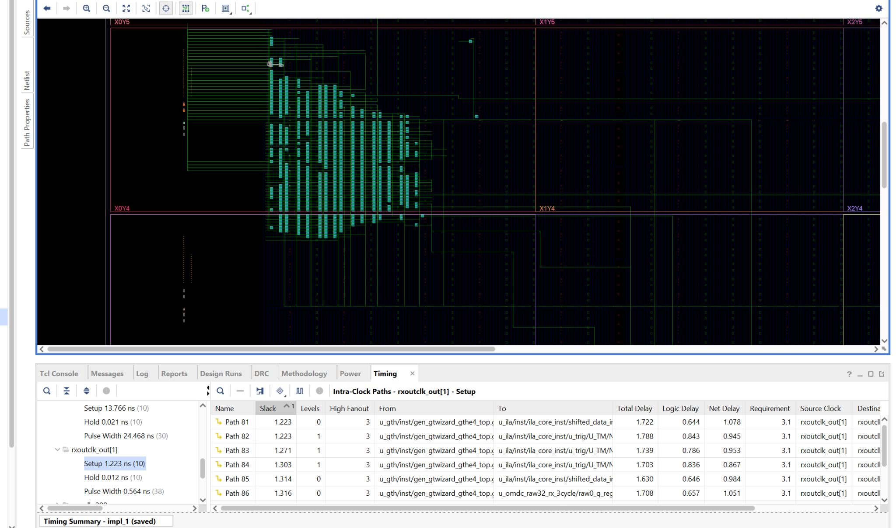
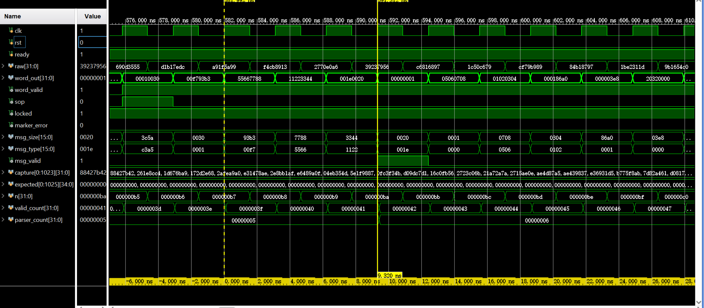
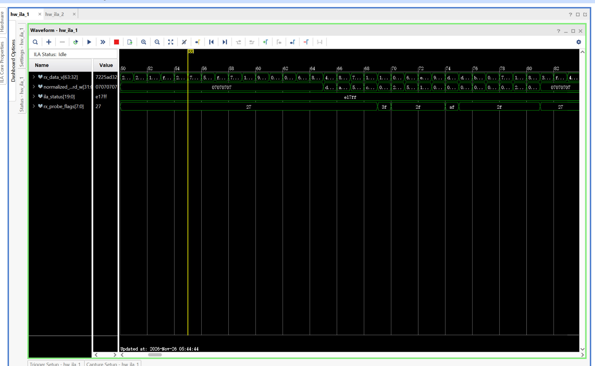
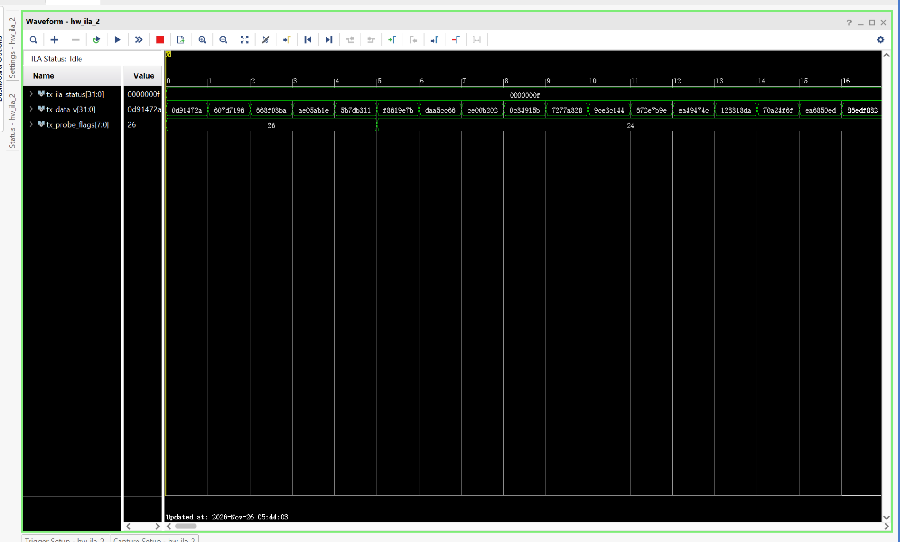

# SnowSakura-FPGA

## 43 ns A/B Market-Data Architecture — HKEX OMD-C on ZU15EG

**2026-11-26: Golden GTH IP frozen. Scrambled RAW32 optical RX/TX running on hardware. The next target: bring A/B arbitration into a 43 ns wire-to-wire budget.**

SnowSakura drives market data through custom FPGA hardware: GTH RAW32, RX normalization, OMD-C parsing, A/B arbitration and TX release. Every cycle is accounted for, from the transceiver to registered logic and physical routing.

| Platform / performance | Specification |
|---|---|
| FPGA | XCZU15EG-FFVB1156-2-I; VU9P physical architecture research |
| Interface | 10.3125 Gb/s GTH RAW32 |
| Golden GTH | X0Y6 / X0Y7, RX and TX Buffer Bypass, QPLL0 |
| Nominal user clock | 322.265625 MHz — 3.103030 ns per cycle |
| Fabric timing constraint | 322.56 MHz over-constraint |
| A/B wire-to-wire design target | **approximately 43 ns** |
| Current milestone | Golden GTH IP freeze and single-path scrambled optical laboratory RX/TX |
| Next | A/B arbitration, NIC replay and independent hardware latency measurement |

### The 43 ns Attack Plan

| Budget component | Allocation |
|---|---:|
| GTH PMA/PCS and associated physical-path allowance | ~18 ns |
| Existing fabric baseline | 6 cycles ≈ 18.62 ns |
| Planned A/B arbitration | 2 cycles ≈ 6.21 ns |
| **Total design budget** | **≈ 42.82 ns — 43 ns class** |

The six-cycle baseline uses the project's upstream launch-to-TX-release accounting; the extra two cycles are the planned arbitration allocation. The ~18 ns transceiver allowance is a design budget. The 43 ns figure is the integrated architecture target; end-to-end hardware latency and its P99.9 will be measured with the planned independent timestamp system.

The single-path architecture has already been through post-implementation SDF timing simulation. The Golden GTH IP is frozen with dual bypass, and a scrambled RAW32 laboratory packet has been recovered through the optical loopback. The next engineering fight is integrating sequence-aware A/B arbitration without giving away the latency budget.

## Current Architecture

**GTH RAW32 → RX capture / normalization / framing → HKEX OMD-C parser → A/B arbitration → TX release.**

The laboratory TX scrambles RAW32 traffic and sends it over SFP+; the RX path recovers packet words and presents a fixed parser interface. Alignment acquisition and packet framing are owned by the RX path. The reusable Golden GTH configuration is the starting point for future CME, LSE and NASDAQ laboratory projects.

- RX/TX dual Buffer Bypass and 125 MHz QPLL0 reference.
- Same-domain payload processing with explicit clock and reset ownership.
- Fixed-field parsing, bounded control and registered pipeline boundaries.
- LUT depth, fanout, placement and routing treated as first-class design constraints.
- RTL simulation, routed STA, SDF timing simulation and on-board ILA evidence.

---

## Built From Almost Nothing — 2026 2.10

Some people may assume that this project came from a well-equipped lab, a research group, or an institutional environment.

It did not.

This project was not built in a university lab. There is no professor behind it, no research group, no company team, no hidden institutional support, and no ready-made hardware lab.

This was the starting environment:

- one laptop
- one desk lamp
- one pen
- public documentation
- repeated engineering iteration


Every RTL file, every testbench, every timing report, every post-simulation result, every architecture revision, and every physical-layer correction came from independent learning: reading documentation, writing code, breaking assumptions, debugging simulations, studying timing paths, and learning how FPGA hardware actually behaves through FDREs, LUTs, routing wires, GTH configuration, CDC boundaries, and post-implementation evidence.

This repository is the record of that process.

---

## The Logic Arena

I am open to serious technical discussion, adversarial review, and collaboration around FPGA market-data infrastructure, deterministic latency, transceiver bring-up, and nanosecond-scale timing closure.

**Email:** `ruansheng333@gmail.com`  
**Status:** open for deep-dive technical discussion and advisory work.

---

# Engineering Log

The dated entries below record the progression from initial RTL and physical timing research to the completed November optical RX/TX milestone.

---

## 2026-03-18 — Initial ZU15EG Physical Timing Log

### Stage 1: Datapath Routing & Net Delay Suppression


At 322 MHz-class timing, routing delay is not background noise. The first major timing lesson was that **Net Delay** can dominate the path even when **Logic Delay** is already small.

Observed timing direction from this phase:

- Logic delay was pushed under approximately 1 ns in representative paths.
- Net delay around the 1.5 ns range became the practical enemy.
- Placement locality and routing shape mattered as much as RTL structure.

The lesson from this phase was simple: a fast-looking RTL path can still fail if the placement creates a long physical route through switch matrices and interconnect tiles.

### Stage 2: Floorplanning & Initial Timing Closure


This phase introduced stricter physical isolation and Pblock-driven locality.

Reported metrics from the original implementation log:

- **WNS:** +0.708 ns
- **WHS:** +0.024 ns
- **Failing endpoints:** 0

This stage established setup and hold closure through physical implementation and placement locality.

### Stage 3: Full Pipeline Squeeze @ 322 MHz


As the parser grew, the timing window became more constrained. This phase established the habit of reading the implementation result as a physical object rather than treating synthesis as the final answer.

Reported metrics from this stage:

- **WNS:** +0.472 ns
- **WHS:** +0.030 ns
- **Failing endpoints:** 0 across 542 endpoints

This stage also made clear that clock tree behavior, register placement, routing detours, and fanout cannot be discussed separately from RTL.

---

## 2026-04-29 — Phase 3 RX-Parser-TX Single-Channel Validation

### I. Latency Validation: Waveform Snapshot


This phase explored the direct RX-to-parser timing model under GTH Raw Mode assumptions. The waveform evidence was used to study deterministic cycle behavior from Start-of-Packet detection into parser output signaling.

### II. Implementation Details: Synthesis Schematic


The purpose of this schematic phase was to inspect whether RTL intent actually mapped to the expected primitive-level structure.

Key physical concerns in this phase:

- FDRE ownership of data and valid signals
- LUT depth on parser control paths
- whether direct mappings remained local or became routed detours
- whether debug/demo outputs distorted the fast-path structure

The schematic inspection established the relationship between RTL structure, primitive mapping and routed timing.

### III. Static Timing Report Summary

Reported metrics preserved from this stage:

- **Timing constraints:** met
- **Failing endpoints:** 0 across 542 endpoints
- **WNS:** +0.472 ns
- **WHS:** +0.030 ns

The tested fabric implementation met its timing constraints.

### Proprietary Constraint Policy

Detailed XDC/TCL constraints, exact coordinate mappings, LOC/BEL assignments, and physical placement strategy are not published in this repository. The public repository shows architecture, testbench direction, timing evidence, and development logs; the proprietary physical implementation scripts remain private.

---

## VU9P Matrix Scaling & SLR Isolation

### Stage NEW: VU9P Matrix Scaling & SLR Isolation

Scaling the core engine to VU9P introduced a different physical enemy: die size and SLR boundary pressure.

Original reported metrics:

- **WNS:** +2.011 ns
- **WHS:** +0.159 ns
- **Net Delay:** 0.760 ns
- **Logic Delay:** 0.217 ns

The key lesson was that interconnect dominated logic delay even more clearly in the larger device context. SLR placement is not a cosmetic floorplanning choice; crossing large physical regions can add nanosecond-scale penalty.

### Stage 2: High-Fanout Congestion Management & Routing Matrix Pressure


High-fanout controls such as `packet_valid`, `sof_detect`, parser enable, and arbitration select lines can become physical routing problems before they become logical problems.

Practical rule established in this phase:

- fanout above roughly 12 on critical controls must be reviewed
- register replication is preferred over allowing a global control net to drive a wide mux field
- locality must be checked in the implemented design, not assumed from RTL hierarchy


This reinforced the rule that moderate fanout can become a timing problem when it forces the router to bridge distant CLEM/CLB regions.

---

## Physical-Layer Control Notes

### Manual Placement, Logic Levels, and Latency

Physical implementation priorities:

- A path with **0 reported logic levels** still has route delay, clock uncertainty, setup requirement, and hold requirement.
- A direct-looking route in Device View must still be verified by `report_timing`.
- Manual placement can reduce detours, but it can also create congestion if the Pblock is wrong or too tight.
- Timing closure is a physical report, not a visual impression.

### Art on Silicon / Routing Evidence


Device views from the routing and placement optimization experiments.

### New Simulation


Simulation established functional behavior and pipeline timing before the subsequent GTH hardware experiments.

---

## Technical Specification & Performance Edge — Historical Summary

The early public specification emphasized several aggressive ideas:

- GTH PMA/PCS bypass exploration
- 128-to-64 sliding-window experiments
- parallel preamble/SFD sniffing
- CARRY8-assisted validation logic
- fixed-stage deterministic pipeline structure

Design principles established during these experiments:

- Sliding-window experiments informed the fixed parser interface and alignment architecture.
- A **parallel preamble scanner** is useful during alignment, but it must not remain as a high-fanout steady-state scanner that loads the critical path.
- **CARRY8** is useful only where its physical carry chain actually reduces delay and where post-route timing confirms it.
- Account for deterministic pipeline latency in cycles and nanoseconds.

### Hardcore Timing Metrics — Historical Post-Implementation Notes

Preserved metrics from the original log:

- **WNS:** +0.511 ns under a 1.2 ns cross-module deadline
- **WHS:** +0.009 ns
- **Reported Logic Level:** 0 on selected paths

The selected implementation achieved positive setup and hold slack under its reported constraints.

### Next Python Test


---

## 2026-05-15 — First Public Simulation Release

### Major Milestone: IEEE 802.3 Framework Refactor & OMD-C Throughput Breakthrough

**Current status at that time:** v0.7-Alpha Refactored


At this point the project moved from isolated timing experiments toward a more complete IEEE 802.3 / OMD-C simulation framework.

Historical result preserved from the original log:

- packet capture improved from roughly 10% to **71.3%**
- test data and testbench direction began moving toward public reproducibility
- the framework started exposing real parser-state and packet-validity issues

Special acknowledgement preserved:

Frank Bruno’s high-speed serial-interface insights were an important external influence during this phase.

### Next Steps From This Phase

The immediate target after this release was to map the remaining loss mechanism and correct the FSM / packet-validity handling without adding latency.

---

## Update: Cracking the 9,900+ Barrier & Public Stress Test Release

The next public stress-test milestone achieved:

- **9,974 / 10,202** packet captures
- approximately **97.8%** success rate under the then-current simulation assumptions
- public stress test using `tb_omdc_top.v` and `raw_data.hex`


### What Was Inside the Stress Test

The testbench attempted to model harsher physical-layer conditions than an ideal single-clock parser test:

- clock skew / ppm offset concept
- random jitter injection at ps-scale simulation resolution
- sub-ns phase perturbation experiments
- raw-data stream ingestion through the simulation framework

This simulation established a stress-test framework for the subsequent hardware development.


### The Final 2.2%

At this time the remaining loss was treated as the final frontier of the simulated RX/parser system.


### Repository Structure — Simulation

```text
/sim/tb_omdc_top.v   : high-precision physical-layer testbench
/sim/raw_data.hex    : HKEX OMD-C raw binary stream test dataset
```

---

## Zero-Detour Manifesto — Routing Geometry Notes

The original Zero-Detour section focused on direct routing geometry and the desire to eliminate unnecessary detours.

Routing objectives:

- Short Manhattan distance can reduce route delay.
- Fewer switchbox hops can reduce uncertainty and skew.
- Use implemented timing reports to evaluate the resulting physical routes.


Physical routing geometry remains central to SnowSakura’s latency optimization.

---

## 2026-05-18 — 100% Zero-Loss Simulation Completion

This milestone marked completion of the first major pre-university simulation target.

Historical result preserved:

- **10,000 / 10,000** packet ingestion in the test stream
- no added pipeline cycle in that simulation architecture
- retained the low-latency wire-to-wire design objective


### Simulation Report — Vivado XSim

Selected paths showed one reported logic level in the tested netlist.

### How the Final Loss Was Removed — Physical-Layer Breakdown

1. **CDC / phase handling discipline**  
   The design moved away from relying on generic elastic buffering and toward deterministic phase/alignment ownership. Current rule: multi-bit payload CDC cannot be “fixed” by Triple-FF; only 1-bit status/control synchronization can use Triple-FF safely. Payload must be same-domain, phase-related, or explicitly normalized.

2. **Combinational logic gating discipline**  
   Critical paths were flattened and reviewed for logic-level count. Current rule: <=2 LUT layers in the GTH RX Data Path is the design limit, and it must be verified after implementation.

3. **TCL-locked floorplanning and timing closure**  
   Pblocks and physical constraints were used to keep the fast path local. Current rule: XDC/TCL constraints are part of the design, and missing endpoints should fail loudly rather than silently falling back.

Preserved reported metric from this phase:

- **WNS:** +0.593 ns on critical control paths in the tested implementation
- **Total Logic Delay:** approximately 0.176 ns on selected paths


---

## Phase 1 Complete — Pre-University Milestone

As of the May 18 milestone, the single-path parser had reached the first public simulation target under the available test environment.

This completed the initial simulation milestone and established the foundation for ZU15EG + SFP hardware integration.

---

## Next Frontier — Dual-Path Line A/B Arbitration & Recovery

HKEX OMD-C dual multicast lines introduce a different problem from physical RX alignment. Packet loss, duplicate packets, delayed packets, and gap recovery are network/protocol-layer concerns and must not be confused with Ethernet bit/block/byte alignment.

The next architecture layer must ingest both Line A and Line B, choose the first valid packet, mask duplicates, detect gaps, and prepare a recovery signal without blowing the latency budget.

### The 2-Cycle Arbitration Challenge

The Line A/B arbitration allocation is **2 cycles**, approximately **6.21 ns** at the nominal 322.265625 MHz RAW32 clock.

Within that physical budget, the design must avoid:

- full 32-bit sequence comparison inside the final mux cycle
- wide if/else priority structures
- unreplicated select signals driving 64-bit or 96-bit muxes
- global high-fanout control nets

The intended direction is a **chunked replicated one-hot arbiter**:

- precompute eligibility before the final arbitration cycle
- replicate local controls by payload chunk
- use one-hot AND-OR muxing instead of wide priority muxing
- keep `out_valid` / TX release control separate from payload chunk selection
- verify that replication survives synthesis and implementation

This arbitration architecture is the next fast-path integration target, alongside NIC replay validation.

---

## 2026-06-24 — Deterministic Research Architecture Update

The original architecture established a fixed-cycle RX normalization, parser, arbitration and TX release datapath, with GTH transceiver latency included in the design budget.

Post-route SDF timing simulation was used to evaluate the FPGA fabric architecture and its registered boundaries.

A revised testbench improved packet-validity handling, RX ownership and physical-layer modeling. The next milestone was real SFP hardware integration.

The ZU15EG board purchase plan moved forward to July, with real SFP hardware validation as the next proof layer.

---

## Development Milestones

- [x] RTL architecture and functional simulation
- [x] 10,000-packet simulation stress test
- [x] Post-route timing and SDF simulation studies
- [x] ZU15EG board bring-up and GTH Top architecture
- [x] Golden GTH IP — RX/TX Dual Buffer Bypass
- [x] Scrambled RAW32 optical transmission and RX recovery
- [x] RX alignment and packet framing demonstrated on the laboratory optical stream
- [x] HKEX OMD-C message-header parser demonstrated in the captured-stream simulation
- [ ] 10GbE NIC market-data replay
- [ ] Integrated Line A/B arbitration and recovery
- [ ] KU040 independent hardware nanosecond timestamping
- [ ] End-to-end latency measurement including P50, P99 and P99.9

---

## 2026-07-03 — SnowSakura Enters Real Hardware Phase

Today I officially ordered the ZU15EG development board and the required 10G optical test setup for SnowSakura-FPGA.

This marks the transition from architecture-level design to real silicon validation.

Until now, the project has mainly focused on RTL structure, GTH latency modeling, XDC constraints, post-route timing strategy, and OMD-C fast-path architecture.

From this point forward, the project moves toward real hardware experiments:

- ZU15EG board bring-up
- GTH physical-layer validation
- PRBS31 and BER testing
- Eye Scan analysis
- Raw Mode validation
- RX Buffer ON stable delivery baseline
- TX Buffer Bypass validation
- post-route STA and timing simulation
- single-lane low-latency market-data path validation

The long-term direction remains clear:

To build a deterministic ultra-low-latency FPGA path for HKEX OMD-C market data, with all claims backed by physical evidence from real hardware, not only simulation.

SnowSakura-FPGA is no longer just an RTL plan.

It is now moving onto real hardware.


---

## 2026-07-07 — RX Buffer ON Bring-up Baseline

The July hardware experiments introduced an RX Buffer ON baseline with TX Buffer Bypass to isolate receive clocking, reset, alignment and link behavior on ZU15EG. The dual-buffer-bypass architecture was retained as the low-latency development direction. Both experiments contributed to the Golden GTH configuration completed in November.

---

## 2026-08-14 — 40ns Research Blade Resumed

This update restores the README to the dated engineering-log form recorded at **2026-07-07 22:55:54 +08:00**, commit `873df2f0f747b98e43f364358faa6bdc6fd45cbf`. That timestamp remains the historical record of the RX Buffer ON baseline and the preserved Version 1 40ns research blade.

Development resumed on the low-latency architecture, starting with an independent dual-line A/B arbitration reference simulation.

### A/B reference architecture

- Message-level Line A/B arbitration keyed by `SeqNum`, never packet-byte equality.
- One output for A/B duplicates; stale duplicates are explicitly removed.
- A missing expected `SeqNum` blocks `SeqNum + 1`; a gap is not silently skipped.
- A/B payload disagreement is a terminal conflict for the Fast Candidate model.
- The reference simulation keeps a fixed two-cycle decision-to-visible boundary and separately counts gap-wait cycles.

The first self-owned Python reference simulation is committed at `a962a69a38468b3421142d4a2d086cd358a63229`, dated **2026-08-14 15:52:23 UTC**. Its positive path, payload-conflict path, and missing-sequence path all pass. The next implementation boundary is the real parser's registered event contract, followed by a bounded two-cycle FDRE/LUT/CARRY8 arbiter and then post-route STA/SDF evidence.

---
## 2026-11-26 — Golden GTH IP Frozen: Optical RAW32 on Silicon

On July 14, SnowSakura reached its GTH Top milestone. On November 26, the **Golden GTH IP freeze** completes the reusable transceiver foundation: Vivado 2022.2, GT Wizard 1.7, X0Y6/X0Y7, X0Y7 TX/RX master, 10.3125 Gb/s RAW32, QPLL0 and **TX/RX Buffer Bypass**.

The laboratory optical path sends scrambled data through SFP+, captures the RX stream and reconstructs the OMD-C test packet. The four captures below show the implementation, simulation, RX and TX evidence.

### Physical implementation and RX timing



| Timing metric | Displayed result |
|---|---:|
| RX clock group setup slack | +1.223 ns |
| RX clock group hold slack | +0.012 ns |
| RX clock group pulse-width slack | +0.564 ns |
| GTH RX to first capture-register setup slack | +1.316 ns |
| GTH RX to first capture-register data path delay | 1.708 ns |
| Reported logic levels on that path | 0 |

The displayed paths belong to the fixed-phase implementation at a displayed 3.1 ns requirement.

### Captured-stream RX-to-parser simulation



The waveform displays a **9.320 ns** cursor interval, with `locked=1`, `marker_error=0`, and a parser-valid event identifying message size `0x0020` and type `0x001E` (Add Order). This is a displayed simulation interval, not the wire-to-wire measurement.

### RX optical hardware ILA



The RX ILA shows changing raw GTH data, normalized output activity and RX probe flags during the optical laboratory capture. The laboratory capture was decoded into the original OMD-C packet.

### TX optical hardware ILA



The TX ILA shows the changing scrambled RAW32 words presented to the GTH transmit path.

### Next targets

1. Integrate message-level A/B arbitration, deduplication, sequence handling and recovery within the two-cycle allocation.
2. Add 10GbE NIC market-data replay as a separate validation path.
3. Build independent KU040 hardware nanosecond timestamping and measure P50, P99 and P99.9 end-to-end latency.
4. Extend the same engineering foundation to CME, LSE and NASDAQ.

---

## Public / Private Boundary

Public repository:

- architecture notes
- selected timing screenshots
- stress-test direction
- development log
- selected measurement direction
- public evidence chain

Private lab:

- Raw Mode RTL
- exact XDC/TCL placement strategy
- exact Pblock coordinates
- LOC/BEL mappings
- phase/alignment calibration scripts
- proprietary implementation constraints

The public repository presents architecture, selected timing and hardware results. Implementation RTL and physical optimization techniques remain private.

---

## Collaboration

### Roadmap and availability

By my second-year summer at university, I will continue building SnowSakura and extend it across the full range of targeted binary market-data protocols. The public evidence chain will be expanded progressively as each layer is completed: protocol-validation results, post-route STA, SDF timing simulation, hardware link evidence, and measured results.

From my second-year summer onward, I will be available to discuss **IP-isolated internships** and **NDA-based technical engagements**. Firms, hedge funds, and specialist recruiters in **Hong Kong** or **Singapore** may contact me directly.

**Email:** `ruansheng333@gmail.com`

The public repository will continue to document the engineering direction and supporting evidence. Exact Raw Mode RTL, XDC/TCL physical-implementation strategy, Pblock coordinates, LOC/BEL mappings, and phase/alignment calibration scripts remain private.
